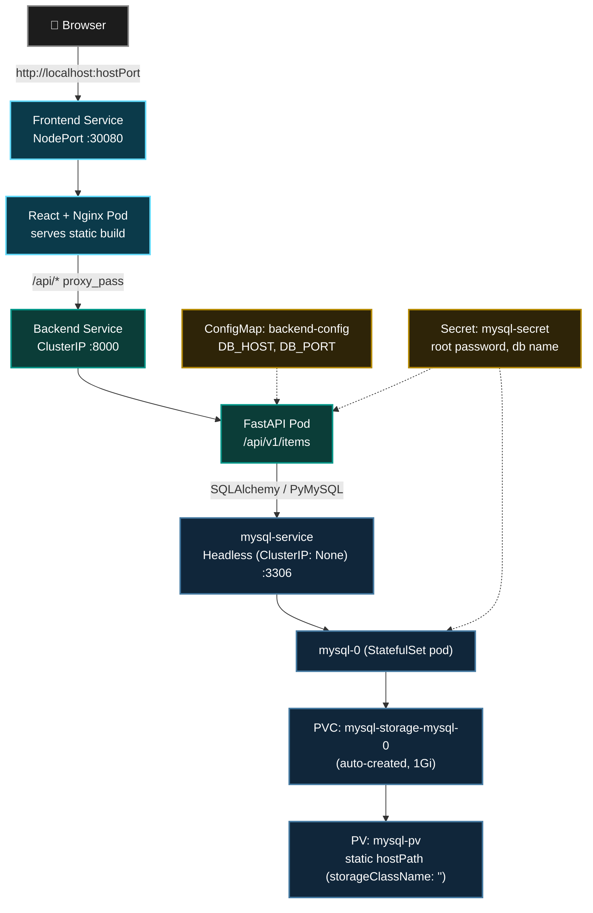
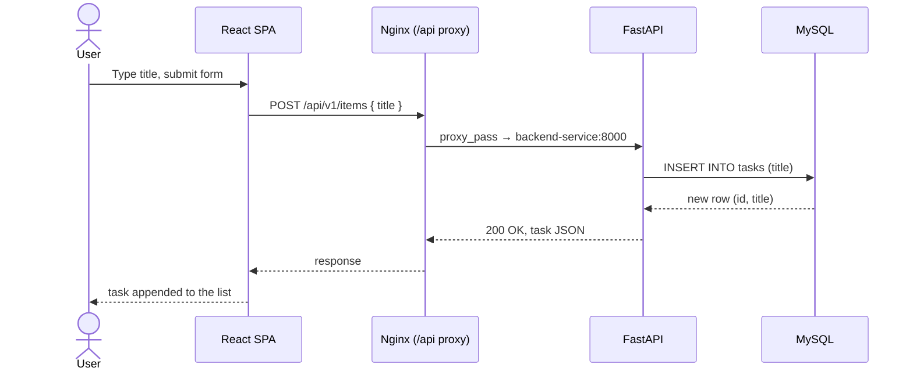
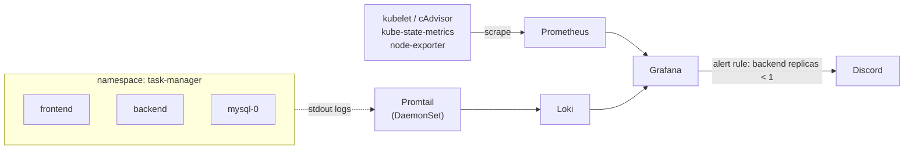
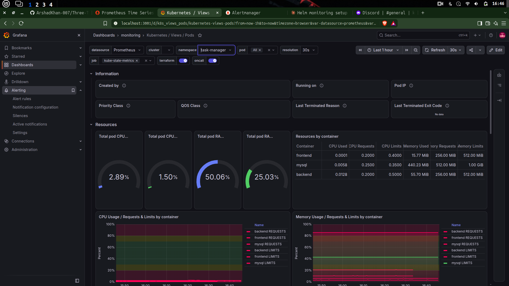
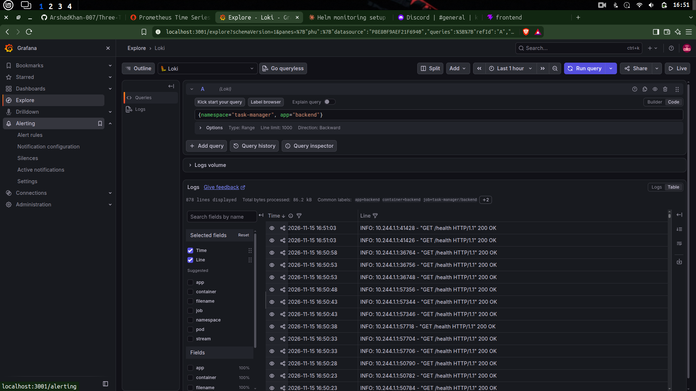
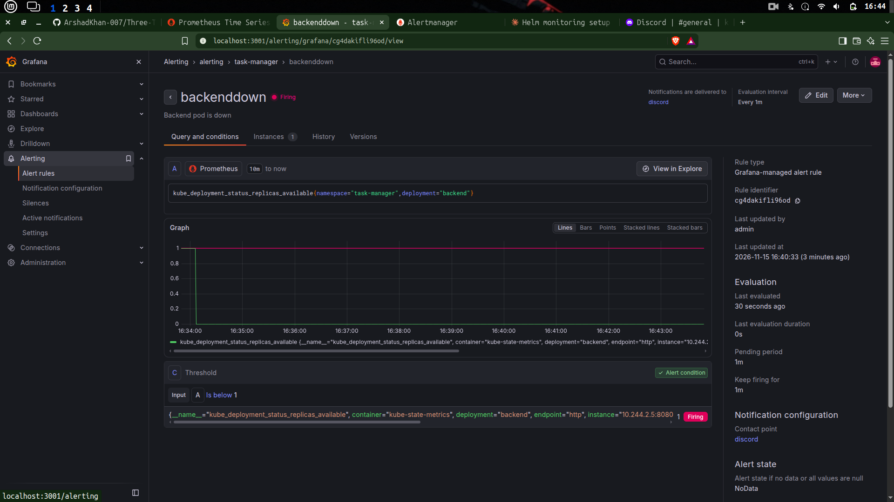
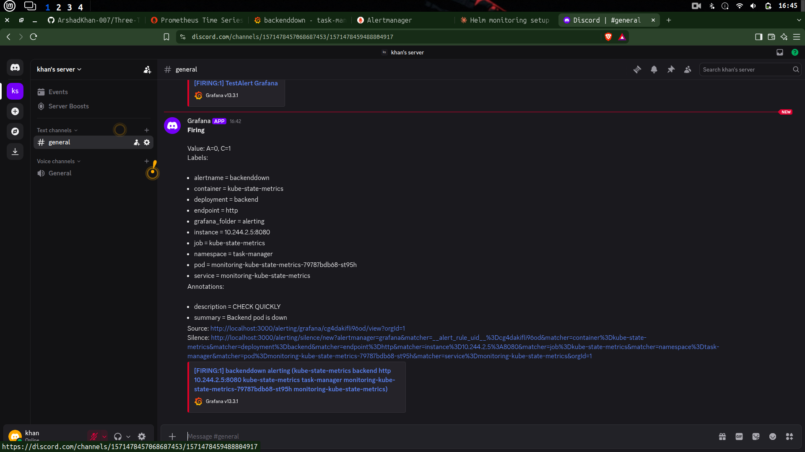
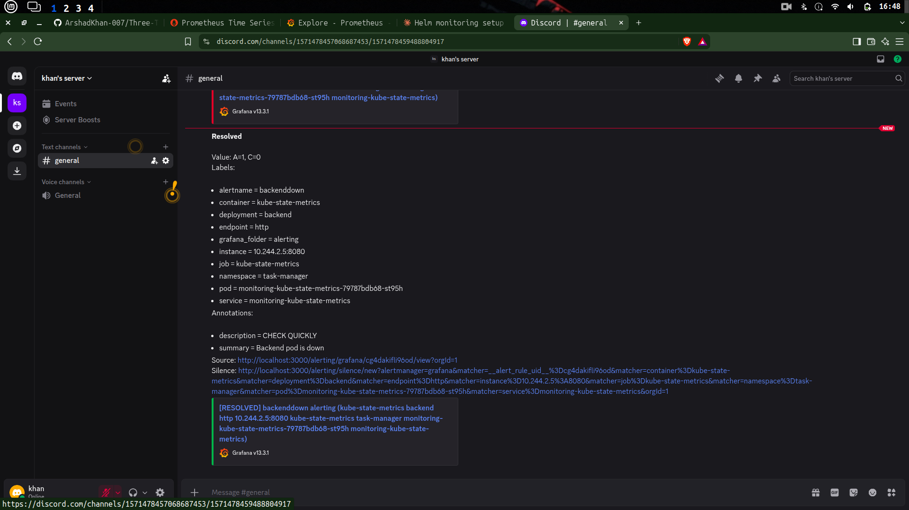

# 🧱 Three-Tier Task Manager on Kubernetes

**React → FastAPI → MySQL, fully containerized and deployed on Kubernetes (kind).**

 [](https://img.shields.io/badge/Backend-FastAPI-009688?logo=fastapi&logoColor=white) [](https://img.shields.io/badge/Database-MySQL_8-4479A1?logo=mysql&logoColor=white) [](https://img.shields.io/badge/Containerized-Docker-2496ED?logo=docker&logoColor=white) [](https://img.shields.io/badge/Orchestration-Kubernetes-326CE5?logo=kubernetes&logoColor=white) [](https://img.shields.io/badge/Web_Server-Nginx-009639?logo=nginx&logoColor=white)

A small Task Manager app used as a hands-on reference for **containerizing a multi-tier app and deploying it to Kubernetes** — Deployments, StatefulSets, Services, ConfigMaps, Secrets, and per-pod persistent storage, all wired together.

---

## 📑 Table of Contents

- [Overview](#-overview)
- [Tech Stack](#-tech-stack)
- [Architecture](#-architecture)
- [Request Flow](#-request-flow-create-a-task)
- [Folder Structure](#-folder-structure)
- [API Reference](#-api-reference)
- [Getting Started](#-getting-started)
  * [Option A — Docker Compose (local dev)](#option-a--docker-compose-local-dev)
  * [Option B — Kubernetes with kind](#option-b--kubernetes-with-kind)
- [Environment Variables](#-environment-variables)
- [Useful Commands](#-useful-commands)
- [Monitoring & Observability](#-monitoring--observability)
- [License](#-license)

---

## 📖 Overview

The app is a minimal task manager: add a task, view the list, delete a task. That's it — the point isn't the feature set, it's the **infrastructure around it**:

- **Frontend** — React (Vite) SPA, built into static files and served by Nginx. Nginx also reverse-proxies `/api/*` to the backend so the browser only ever talks to one origin.
- **Backend** — FastAPI, layered into `api / core / models / schemas`, talking to MySQL via SQLAlchemy + PyMySQL.
- **Database** — MySQL 8, with schema created automatically on backend startup (`Base.metadata.create_all`). Runs as a **StatefulSet** with a headless Service, since a database is stateful workload and needs stable identity + per-pod storage — not a stateless `Deployment`.
- **Runtime** — every tier has its own Dockerfile. `docker-compose.yml` runs all three locally; the `K8s/` manifests run the same three tiers as a real cluster workload (frontend/backend Deployments + Services, MySQL StatefulSet + headless Service, ConfigMap, Secret, and dynamically-provisioned per-pod storage via `volumeClaimTemplates`).

---

## 🧰 Tech Stack

| Layer                 | Technology                                          |
| --------------------- | --------------------------------------------------- |
| Frontend              | React 19 + Vite, Axios                              |
| Web server (frontend) | Nginx (reverse proxy to backend)                    |
| Backend               | FastAPI + SQLAlchemy + PyMySQL, Uvicorn             |
| Database              | MySQL 8                                             |
| Containerization      | Docker (multi-stage build for frontend)             |
| Local orchestration   | Docker Compose                                      |
| Cluster orchestration | Kubernetes (tested with `kind`)                     |
| Config / secrets      | ConfigMap + Secret                                  |
| Persistence           | StatefulSet `volumeClaimTemplates` bound to a static hostPath PV (kind-only) |

---

## 🏗 Architecture

Only the frontend is reachable from outside the cluster — backend and MySQL stay `ClusterIP`-only, so the frontend can't be bypassed to hit the database directly.

MySQL runs as a **StatefulSet** (not a Deployment) behind a **headless Service** (`clusterIP: None`), giving it a stable pod identity (`mysql-0`) and a dedicated, per-pod PVC created automatically from `volumeClaimTemplates`. That PVC statically binds to `mysql-pv` (a hostPath PV, `storageClassName: ""` on both sides so `kind`'s default `local-path` provisioner doesn't intercept it) — kept intentional so data lands at a known path on the host for a `kind` cluster; a production cluster would drop the static PV and let a cloud CSI driver provision dynamically instead.



All three tiers run inside the `task-manager` namespace.

---

## 🔁 Request Flow (create a task)



Delete follows the same path: `DELETE /api/v1/items/{id}` → 404 if the task doesn't exist, otherwise the row is removed and the UI drops it from state.

---

## 📁 Folder Structure

```
.
├── K8s/
│   ├── namespace.yml
│   ├── backend/
│   │   ├── ConfigMap.yml
│   │   ├── deployment.yml
│   │   └── service.yml
│   ├── frontend/
│   │   ├── deployment.yml
│   │   └── service.yml
│   └── mysql/
│       ├── statefulset.yml          # StatefulSet (was deployment.yml)
│       ├── service.yml              # headless Service, clusterIP: None
│       ├── secret.yml
│       └── pv.yml                   # static hostPath PV — kind-only, see note below
│
├── backend/
│   ├── Dockerfile
│   ├── requirements.txt
│   └── app/
│       ├── main.py                  # FastAPI app, CORS, /health
│       ├── dependencies.py          # DB session dependency
│       ├── core/
│       │   └── database.py          # engine, SessionLocal, Base
│       ├── models/
│       │   └── task.py              # SQLAlchemy Task model
│       ├── schemas/
│       │   └── task.py              # Pydantic TaskCreate / TaskResponse
│       └── api/v1/
│           ├── router.py
│           └── endpoints/
│               └── items.py         # GET / POST / DELETE /items
│
├── frontend/
│   ├── Dockerfile                   # multi-stage: node build → nginx serve
│   ├── nginx.conf                   # static files + /api reverse proxy
│   └── src/
│       ├── main.jsx / App.jsx
│       ├── pages/Home.jsx
│       ├── components/tasks/        # TaskForm, TaskList, TaskCard
│       ├── hooks/useTasks.js        # fetch/add/delete state logic
│       ├── services/                # apiClient.js, taskService.js
│       └── constants/api.js
│
├── monitoring-assests/              # README screenshots
├── docker-compose.yml
└── README.md
```

> ⚠️ Note the real casing: it's `K8s/`, not `k8s/`, and the manifests are `.yml`, not `.yaml`. Every `kubectl apply -f k8s/...` command floating around in older docs for this repo will fail on a case-sensitive filesystem — the commands below use the actual paths.
>
> `K8s/mysql/pvc.yml` is gone — storage is now provisioned per-pod by the StatefulSet's `volumeClaimTemplates`, not a manually-written PVC. `pv.yml` is kept as a **static hostPath PV bound directly to `volumeClaimTemplates`** (`storageClassName: ""` on both sides) — this is a `kind`-specific choice for full control over where data lands on the host. On a real cluster (e.g. EKS with the EBS CSI driver), `pv.yml` would be deleted entirely and `volumeClaimTemplates` would reference the cloud provider's StorageClass for dynamic provisioning instead — writing a static PV by hand isn't the pattern there.

---

## 🔌 API Reference

Base path: `/api/v1`

| Method | Endpoint             | Body                  | Description                                               |
| ------ | -------------------- | ---------------------- | --------------------------------------------------------- |
| GET    | `/health`            | —                      | Liveness/readiness check, returns `{"status": "healthy"}` |
| GET    | `/api/v1/items`      | —                      | List all tasks                                            |
| POST   | `/api/v1/items`      | `{ "title": string }` | Create a task                                             |
| DELETE | `/api/v1/items/{id}` | —                      | Delete a task by id, `404` if missing                     |

There's no update/edit endpoint currently — tasks are create-or-delete only.

---

## 🚀 Getting Started

### Prerequisites

- Docker
- For Kubernetes: `kubectl` and `kind`

### Option A — Docker Compose (local dev)

The compose file expects two env files that are **gitignored on purpose** (they hold DB credentials) — create them yourself first, using exact `KEY=VALUE` syntax (not `KEY: VALUE` — that's YAML syntax, and Compose's env file parser silently fails to pick it up):

```
# backend/.env.backend
DB_HOST=mysql
DB_PORT=3306
DB_USER=root
DB_PASSWORD=choose-a-password
DB_NAME=task_manager
```

```
# .env.db  (repo root)
MYSQL_ROOT_PASSWORD=choose-a-password   # must match DB_PASSWORD above, character-for-character
MYSQL_DATABASE=task_manager
```

The full `docker-compose.yml` runs all three tiers. Note the `healthcheck` on `mysql` plus `condition: service_healthy` on `backend`, so the backend waits for MySQL to actually accept connections instead of racing it on first boot, and the `BACKEND_HOST` / `BACKEND_PORT` variables that tell Nginx in the frontend where to proxy `/api`:

```yaml
services:

  frontend:
    build:
      context: ./frontend
    container_name: task-manager-frontend
    environment:
      - BACKEND_HOST=backend
      - BACKEND_PORT=8000
    ports:
      - "3000:80"
    depends_on:
      - backend
    restart: unless-stopped

  backend:
    build:
      context: ./backend
    container_name: task-manager-backend
    ports:
      - "8000:8000"
    env_file:
      - ./backend/.env.backend
    depends_on:
      mysql:
        condition: service_healthy   # waits for the healthcheck below, not just "container started"
    restart: unless-stopped

  mysql:
    image: mysql:8
    container_name: task-manager-mysql
    ports:
      - "3306:3306"
    env_file:
      - .env.db
    volumes:
      - mysql_data:/var/lib/mysql
    healthcheck:
      test: ["CMD", "mysqladmin", "ping", "-h", "localhost"]
      interval: 10s
      timeout: 5s
      retries: 5
      start_period: 10s
    restart: unless-stopped

volumes:
  mysql_data:
```

Then:

```
git clone https://github.com/ArshadKhan-007/Three-Tier-Kubernetes-App.git
cd Three-Tier-Kubernetes-App
docker compose down -v          # if re-running: wipe any stale mysql volume first —
                                 # MySQL only reads MYSQL_ROOT_PASSWORD on first init,
                                 # a leftover volume silently ignores new env files
docker compose up --build
```

- Frontend → <http://localhost:3000>
- Backend → <http://localhost:8000/docs> (Swagger UI)
- Sanity check: `curl http://localhost:8000/health` → `{"status":"healthy"}`

### Option B — Kubernetes with kind

`kind` does **not** expose NodePort services to your host by default — you need a cluster config with an explicit port mapping, or the app will deploy fine and still be unreachable.

```yaml
# kind-config.yml
kind: Cluster
apiVersion: kind.x-k8s.io/v1alpha4
nodes:
  - role: control-plane
    extraPortMappings:
      - containerPort: 30080   # must match nodePort in K8s/frontend/service.yml — do not change
        hostPort: 30080        # the port YOU access on localhost — change this to whatever you like (e.g. 3001)
        protocol: TCP
```

> `containerPort` and `hostPort` are not the same thing. `containerPort` has to stay `30080` because that's the `nodePort` hardcoded in `K8s/frontend/service.yml` — that's the fixed end of the chain. `hostPort` is just where *you* want it reachable on your machine; set it to `3001`, `8080`, whatever's free. If your `kind-config.yml` has `hostPort: 3001`, then the app is at `http://localhost:3001`, not `:30080` — the example below uses `30080` for both since that's the default, but swap in your actual `hostPort` value.

```
kind create cluster --name three-tier --config kind-config.yml
kubectl cluster-info
```

Deploy in order (mysql before backend, backend before frontend — nothing here waits on readiness across resources):

```
kubectl apply -f K8s/namespace.yml
kubectl apply -f K8s/mysql/
kubectl apply -f K8s/backend/
kubectl apply -f K8s/frontend/
```

Watch it come up (MySQL pod will come up as `mysql-0`, not a random hash suffix — that's the StatefulSet giving it a stable name):

```
kubectl get pods -n task-manager -w
```

Once everything is `Running`, open **http://localhost:\<your hostPort\>** — `http://localhost:30080` only if you kept the default; check your own `kind-config.yml` if you changed it.

Didn't set up the port mapping, or on a cluster where NodePort isn't reachable? Fall back to port-forwarding:

```
kubectl port-forward svc/frontend-service 3000:80 -n task-manager
# → http://localhost:3000
```

---

## 🔐 Environment Variables

### Backend (`backend/app/core/database.py`)

| Variable      | Default        | Used for            |
| ------------- | -------------- | -------------------- |
| `DB_HOST`     | `localhost`    | MySQL host           |
| `DB_PORT`     | `3306`         | MySQL port           |
| `DB_USER`     | `xyz`          | MySQL user           |
| `DB_PASSWORD` | `RtabcPass`    | MySQL password        |
| `DB_NAME`     | `task_manager` | MySQL database name  |

In Kubernetes, `DB_HOST`/`DB_PORT` come from the `backend-config` ConfigMap, and `DB_PASSWORD`/`DB_NAME` come from the `mysql-secret` Secret. `DB_USER` is hardcoded to `root` directly in `K8s/backend/deployment.yml`.

---

## 🛠 Useful Commands

```
# Pods / services / deployments / statefulsets
kubectl get pods -n task-manager
kubectl get svc -n task-manager
kubectl get deployments -n task-manager
kubectl get statefulsets -n task-manager
kubectl get pvc -n task-manager

# Logs
kubectl logs -f deployment/backend -n task-manager
kubectl logs -f deployment/frontend -n task-manager
kubectl logs -f statefulset/mysql -n task-manager
# or, since it's a named pod:
kubectl logs -f mysql-0 -n task-manager

# Shell into a pod
kubectl exec -it deployment/backend -n task-manager -- /bin/bash
kubectl exec -it mysql-0 -n task-manager -- mysql -u root -p

# Tear down
kubectl delete -f K8s/frontend/
kubectl delete -f K8s/backend/
kubectl delete -f K8s/mysql/
kubectl delete -f K8s/namespace.yml
kind delete cluster --name three-tier
```

---

## 📊 Monitoring & Observability

The app is observed with the standard open-source stack, installed **entirely with Helm** into a dedicated `monitoring` namespace (no hand-written manifests):

| Concern | Tool | Helm chart |
| ------- | ---- | ---------- |
| Metrics | Prometheus, node-exporter, kube-state-metrics | `prometheus-community/kube-prometheus-stack` |
| Dashboards | Grafana | `kube-prometheus-stack` |
| Logs | Loki + Promtail | `grafana/loki-stack` |
| Alerting | Grafana alert rule → Discord contact point | `kube-prometheus-stack` (Grafana) |



### Install

```bash
helm repo add grafana https://grafana.github.io/helm-charts
helm repo add prometheus-community https://prometheus-community.github.io/helm-charts
helm repo update

# Logs: Loki + Promtail
helm install loki grafana/loki-stack -n monitoring --create-namespace \
  --set loki.enabled=true \
  --set promtail.enabled=true \
  --set loki.persistence.enabled=true \
  --set loki.persistence.size=5Gi \
  --set loki.isDefault=false

# Metrics + Grafana + Alertmanager
helm install monitoring prometheus-community/kube-prometheus-stack -n monitoring \
  --set kubeEtcd.enabled=false \
  --set kubeScheduler.enabled=false \
  --set kubeControllerManager.enabled=false \
  --set kubeProxy.enabled=false \
  --set grafana.adminPassword='<your-password>' \
  --set 'grafana.additionalDataSources[0].name=Loki' \
  --set 'grafana.additionalDataSources[0].type=loki' \
  --set 'grafana.additionalDataSources[0].access=proxy' \
  --set 'grafana.additionalDataSources[0].url=http://loki.monitoring.svc:3100'

kubectl get pods -n monitoring
```

> The `kubeEtcd` / `kubeScheduler` / `kubeControllerManager` / `kubeProxy` flags are disabled because on `kind` those control-plane endpoints aren't scrapeable and would show up as permanently "down" targets.

Open Grafana:

```bash
kubectl port-forward svc/monitoring-grafana 3001:80 -n monitoring
# http://localhost:3001  (user: admin)
```

### Kubernetes metrics dashboard

Imported the community dashboard **Kubernetes / Views / Pods** (Grafana.com ID `15760`) via **Dashboards → New → Import**. Filtered to the `task-manager` namespace, it shows CPU / memory usage against requests and limits for the `frontend`, `backend` and `mysql` containers.



### Application logs with Loki

Promtail runs on every node, ships container logs to Loki, and Grafana queries them with LogQL (**Explore → Loki**):

```
{namespace="task-manager", app="backend"}
```



### Alerting

A Grafana-managed alert rule, `backenddown`, watches the backend Deployment and notifies a **Discord** channel through a Grafana contact point.

| Setting | Value |
| ------- | ----- |
| Query | `kube_deployment_status_replicas_available{namespace="task-manager",deployment="backend"}` |
| Condition | `IS BELOW 1` |
| Evaluation interval / pending period | 1m / 1m |
| Contact point | `discord` (webhook) |

Trigger it by taking the backend down:

```bash
kubectl scale deployment backend -n task-manager --replicas=0   # alert fires
kubectl scale deployment backend -n task-manager --replicas=1   # alert resolves
```

**Alert firing in Grafana:**



**Discord notification (firing):**



**Discord notification (resolved):**



### Problems hit along the way

| Problem | Cause | Fix |
| ------- | ----- | --- |
| Grafana pod in `CrashLoopBackOff` | `loki-stack` provisions its Loki datasource as default, and so does Prometheus. Grafana allows only one default per org. | `--set loki.isDefault=false` |
| Alert never fired | Threshold was `IS ABOVE 1`. The healthy value is `1` and the failure value is `0`, so the condition could never be true. | Changed to `IS BELOW 1` |
| Imported dashboards lost after a Grafana restart | Grafana has no persistent volume in this setup. | Re-import the dashboard (or enable `grafana.persistence`) |

### Notes and next steps

- Grafana-managed rules (used here) and Prometheus rules are separate systems. The ~100 built-in Prometheus alert rules route through **Alertmanager**, not through Grafana contact points.
- Current metrics are infrastructure-level (CPU, memory, pod state). Application-level metrics (request rate, latency, 5xx) need a `/metrics` endpoint in FastAPI plus a `ServiceMonitor`.
- Promtail is deprecated upstream; Grafana Alloy is its replacement.
- Never commit the Grafana admin password or the Discord webhook URL.

Tear down:

```bash
helm uninstall monitoring -n monitoring
helm uninstall loki -n monitoring
kubectl delete namespace monitoring
```

---

## 📄 License

No license file is currently included in this repository — treat it as **all rights reserved** by default until one is added. If the intent is for others to freely use/modify this (which is reasonable for a learning project), add an explicit `LICENSE` file (MIT is the standard low-friction choice for this kind of project).
